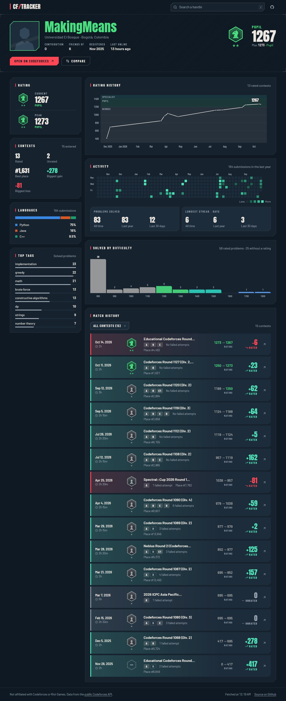
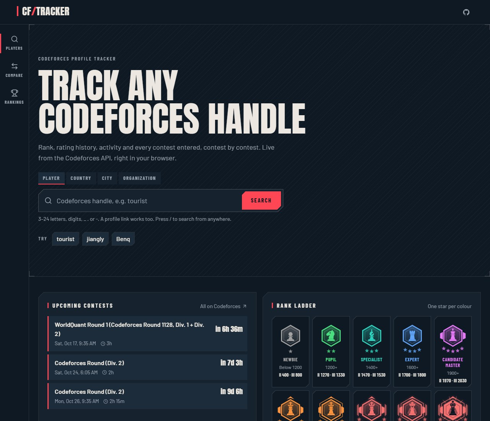
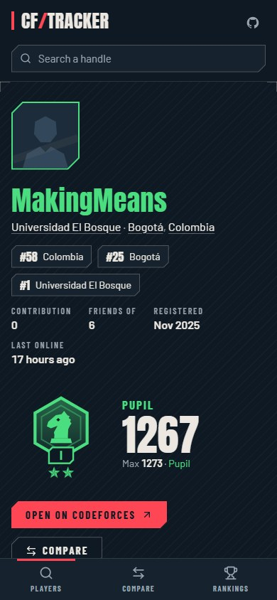

# CF/TRACKER

Look up any Codeforces handle and see its rank, rating history, activity heatmap and contest-by-contest
match history, styled like a game tracker. Think tracker.gg for Valorant, but for Codeforces.

[](https://github.com/MakingMeans/codeforces-tracker/actions/workflows/deploy.yml)

**Live:** https://makingmeans.github.io/codeforces-tracker/
**Example:** https://makingmeans.github.io/codeforces-tracker/?handle=tourist



<p>
  
  
</p>

## Features

- **Search any handle.** The handle is checked in the browser (3–24 letters, digits, `_`, `.` or `-`)
  before Codeforces is asked. Recent searches are remembered on your device and can be removed one by one.
- **Profile header.** Photo, handle in its rank colour, organisation and location, rank emblem, current
  and peak rating, contribution, friends, registration date and last visit, plus a link to the profile
  on Codeforces.
- **Rating chart.** Rating over time on top of the coloured rank bands, with a cursor that snaps to the
  nearest contest. Arrow keys, Home and End walk through it from the keyboard.
- **Activity.** A heatmap of up to 53 weeks of submissions in your local time zone, problems solved
  (all time, last year, last month) and longest streaks of consecutive days.
- **Match history.** Every contest entered live, most recent first, Valorant-style: tinted by result,
  with the rank held going in, problems solved and missed, failed attempts, place, rating before → after
  and the delta. Filter by All / Rated / Unrated.
- **Insights.** Problems solved by difficulty, most-solved tags, languages used and a contest summary
  (best place, biggest gain, biggest loss).
- **Upcoming contests** on the home page, with a countdown.
- **Compare two handles** side by side, including the contests both of them entered.

Ranks are drawn as original angular emblems, one per rank. Codeforces has no rank artwork of its own.

## Usage

| What                   | How                                                   |
| ---------------------- | ----------------------------------------------------- |
| Look up a handle       | Type it in the search box, or open `?handle=<handle>` |
| Compare two handles    | `?handle=<a>&vs=<b>`                                  |
| Jump to the search box | Press `/`                                             |

Every view is a plain URL, so it can be bookmarked or shared, and the browser's back and forward buttons
work. Paths like `/u/tourist` are not used because GitHub Pages cannot route them.

## How it works

There is no backend. Your browser calls the public [Codeforces API](https://codeforces.com/apiHelp)
directly; it answers with `Access-Control-Allow-Origin: *`, so no proxy or key is involved.

| Endpoint       | Used for                                                                               |
| -------------- | -------------------------------------------------------------------------------------- |
| `user.info`    | Profile header. Called first, so an unknown handle fails fast                          |
| `user.rating`  | Rating chart, rated contests, deltas and places                                        |
| `user.status`  | Activity, solved problems, streaks, per-contest problems and attempts, languages, tags |
| `contest.list` | Contest names, durations, phases and upcoming contests                                 |

- **Rate limit.** Codeforces allows about one call every two seconds. When it answers HTTP 429 or
  `Call limit exceeded`, the request is retried after 2, 4 and 6 seconds. At most three requests are
  in flight at once.
- **Caching.** `contest.list` is the same for everyone and is kept in `localStorage` for an hour. Each
  profile is kept in memory and in `sessionStorage` for five minutes, so going back is instant. Only
  the processed profile is stored: raw submissions can exceed 6 MB.
- **Big accounts.** `user.status` returns every submission ever made (over 11,000 for some users, about
  6 MB of JSON). It is downloaded, parsed and processed once, in a Web Worker, so the page never freezes;
  the results then render in a React transition. Measured on the production build with `jiangly`, no
  main-thread task reaches 50 ms on a desktop CPU.
- **Photos.** `userpic.codeforces.org` sometimes fails, and its CDN can cache the error for days. The
  photo is tried as given, then with a cache-busting query, then the small avatar, then a neutral local
  image.

Match history rules, in short: only live participation counts (practice and virtual runs do not).
Problems and attempts are rebuilt from your own submissions, because `contest.standings` no longer
filters by handle for anonymous callers. A contest with no rating change yet is shown as **Pending**
for up to three days after it ends.

## Run locally

Requires Node.js 22.

```bash
git clone https://github.com/MakingMeans/codeforces-tracker.git
cd codeforces-tracker
npm ci
npm run dev
```

Then open http://localhost:5173/codeforces-tracker/. The sub-path matches the one GitHub Pages serves.

### Scripts

| Script            | What it does                                      |
| ----------------- | ------------------------------------------------- |
| `npm run dev`     | Development server with hot reload                |
| `npm run build`   | Type-check and build the static site into `dist/` |
| `npm run preview` | Serve the production build locally                |
| `npm run lint`    | ESLint                                            |
| `npm test`        | Vitest, for the data rules                        |
| `npm run format`  | Prettier                                          |

The tests run in the America/New_York time zone on purpose, so the day and streak rules are checked
across a daylight-saving change.

## Project structure

```
src/
  lib/
    api/          Codeforces client: retries, rate limiting, cancellation, typed errors
    codeforces/   pure data rules: ranks, contests, activity, insights, comparison (tested)
    charts/       scales and grids behind the charts (tested)
    emblem.ts     the rank emblems as SVG markup (tested against docs/design)
  workers/        the details worker: downloads and processes user.status off the main thread
  components/     layout · ui · search · home · profile · charts · history · compare · states
  pages/          home, profile, compare
  index.css       design tokens and the few component styles written as CSS
tests/fixtures/   small hand-written API responses used by the tests
docs/DESIGN.md    design system: colours, type, shapes, charts, emblems
docs/design/      approved visual sample, rank emblem source, reference sheet and SVG exports
public/           static files, resolved through import.meta.env.BASE_URL
```

## Deployment

`.github/workflows/deploy.yml` builds the site and publishes it to GitHub Pages on every push to `main`.
The repository uses **Settings → Pages → Source: GitHub Actions**.

The site lives under a repository sub-path, so `vite.config.ts` sets `base: '/codeforces-tracker/'` and
files in `public/` are referenced through `import.meta.env.BASE_URL`.

## Contributing

Issues and pull requests are welcome.

1. Branch from `main`.
2. Keep commits small and use [Conventional Commits](https://www.conventionalcommits.org/)
   (`feat:`, `fix:`, `chore:`, `docs:`, `test:`, `perf:`).
3. Before opening a pull request, run `npm run lint`, `npm test` and `npm run build`. CI runs the same
   checks.
4. For UI work, follow [`docs/DESIGN.md`](docs/DESIGN.md) so new pieces match the rest of the page.
   Anything that changes a data rule needs a test with a fixture.

## Roadmap

- [x] Plan and README
- [x] Design system and rank emblems (`docs/DESIGN.md`, `docs/design/`)
- [x] Project scaffold and CI
- [x] Data layer ported from the reference, with tests
- [x] Home page: search, recent searches, examples, rank ladder, upcoming contests
- [x] Profile header, rank emblems, loading and error states
- [x] Rating chart
- [x] Activity heatmap, solved and streak cards
- [x] Match history
- [x] Difficulty, tags, languages and contest summary
- [x] Performance pass for very large accounts (Web Worker)
- [x] Compare two handles
- [x] Accessibility pass, screenshots
- [ ] First deployment to GitHub Pages

## Credits

- The data rules are ported from the Codeforces panel of
  [david-garcia-portfolio](https://github.com/MakingMeans/david-garcia-portfolio) (MIT).
- Fonts: [Anton](https://fonts.google.com/specimen/Anton) and
  [Barlow](https://fonts.google.com/specimen/Barlow), both under the SIL Open Font License.
- Icons: [Lucide](https://lucide.dev) (ISC).

## Disclaimer

Not affiliated with Codeforces or Riot Games. Data from the public Codeforces API. The visual style is
inspired by competitive game trackers. It uses no Riot or Valorant logos, artwork or fonts.

## License

MIT. See [LICENSE](LICENSE).
